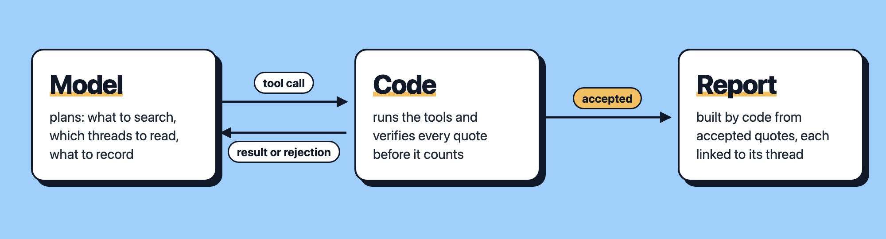

<p align="center">
  <a href="https://github.com/arminasbek/pain-point-agent/actions/workflows/ci.yml"></a>
  <a href="https://github.com/arminasbek/pain-point-agent/releases"></a>
  
  
  
</p>

An AI agent that searches public sources (e.g. forums, Hacker News, GitHub issues) for a niche and reports what people struggle with. **Every finding is backed by a quote that code has checked against the source**, so the report cannot contain a complaint the model made up.

- **Quotes are verified, not trusted.** Each quote must appear word for word in a thread the agent actually fetched.
- **Two LLM judges filter the evidence.** One rejects quotes that are not complaints, one rejects quotes that belong to a different problem or niche.
- **Measured, not assumed.** Labelled eval sets for both judges, a stability check across repeated runs, cost per run. Numbers [below](#evals).
- **Built from scratch, on purpose.** A hand-written tool-use loop on the Anthropic API instead of a framework, so every step the agent takes is visible and covered by tests in CI.

## Quick start

Needs Python 3.14 and an [Anthropic API key](https://console.anthropic.com/). [uv](https://docs.astral.sh/uv/) is recommended: it installs Python 3.14 for you if it is missing.

```bash
git clone https://github.com/arminasbek/pain-point-agent.git
cd pain-point-agent
echo "ANTHROPIC_API_KEY=sk-ant-..." > .env

uv sync
uv run pain-point-agent "n8n + AI agents"
```

Without uv:

```bash
python3.14 -m venv .venv && source .venv/bin/activate
pip install -e .
pain-point-agent "n8n + AI agents"
```

A run costs about $0.01 with Claude Haiku 5.5. Progress shows while it runs, the report prints at the end, and the whole run (report, evidence, rejections, cost) is saved to a local SQLite database in `data/`. Exit code 2 means the run stopped early; the report still shows what was verified before the stop.

| Option | Default | What it does |
|---|---|---|
| `--trace` | off | Print every round (tool calls, rejections, tokens, cost) and save the conversation to `traces/` |
| `--runs N` | 1 | Run N times and keep only the threads most runs agree on |
| `--judge-votes N` | 1 | Ask each judge N times and take the majority (a tie rejects) |
| `--max-age-days N` | no limit | Reject evidence from posts older than N days |
| `--no-save` | off (runs are saved) | Do not save the run to the local SQLite database |

Optional: `GITHUB_TOKEN` in `.env` raises the GitHub limit from 60 to 5,000 requests per hour.

## Example

A real run, shortened. While it runs, the terminal shows each tool call the model makes (`->`) and each time the code says no (`rejected:`):

```console
$ uv run pain-point-agent "home energy monitoring"
-> search(homeassistant, "energy monitoring")
-> search(homeassistant, "power meter inaccurate")
-> search(homeassistant, "smart plug energy")
   rejected: Already 2 searches in homeassistant. Search a different source that fits the niche.
-> search(hn, "home energy monitor")
-> fetch(homeassistant, 882702)
-> record_pain("Smart meter/plug energy readings inaccurate or unreliable", 882702, "I’m experiencing inaccurate…")
...
-> fetch(homeassistant, 986176)
-> record_pain("Monitor hardware failure and costly replacement…", 986176, "But the voltage i…")
   rejected: Quote does not fit the problem: The quote is about a voltage calibration reading error…
-> record_pain("Appliance state detection breaks on noisy power readings", 986176, "However the amperage…")
   rejected: Quote does not fit the problem: The quote describes systematic calibration error…
-> record_pain("Smart meter/plug energy readings inaccurate or unreliable", 986176, "However the amperage…")
-> finish(...)

Cost ≈ $0.0112

# Pain report: home energy monitoring

## Theme (inference)
Home energy monitors give readings users can't trust, or can't get at, from their own devices and utility meters.

## 1. Smart meter/plug energy readings inaccurate or unreliable
Threads: 3

> "I’m experiencing inaccurate power consumption readings with my three Shelly Plug S Gen3 devices in Home Assistant."
> Shelly Plug S Gen3 energy meter values are wrong (2025-04-27)

> "However the amperage & watts are way off, and the voltage is ~ 5% off."
> Howto calibrate circuitsetup energy monitor (2026-03-18)
...

## 2. Utility smart meter data not accessible in real time
Threads: 2

> "Unfortunately this is a closed system where the energy company will not let you access the data outside of their own dashboard."
> What's that touchscreen in my room? (2024-01-22)
...

## Single-thread leads (not enough evidence)
- Monitor hardware failure and costly replacement for whole-panel monitoring
- Appliance state detection breaks on noisy power readings
```

The fit judge rejected the calibration quote twice, and on the third try the model filed it under the problem it actually describes. The report at the end is built by code from the accepted evidence only, and each quote in it links to its thread. The theme is the model's inference and is labelled as one. Results vary between runs, see [Evals](#evals).

## How it works

The model plans, the code referees.



1. The model searches the sources and reads threads (`search`, `fetch`).
2. It proposes evidence: a problem and a quote (`record_pain`).
3. The code checks the quote. If a check fails, the model gets the reason and tries again.
4. When the model calls `finish`, the code builds the report from accepted quotes only.

**What gets rejected** (112 rejections across 16 test runs during development):

| Check | The question | Rejected |
|---|---|---|
| Real | Is the quote word for word in a thread the agent fetched? | 10 |
| Counted once | Is this thread or quote already used? | 54 |
| Meaningful | Is it a complaint, and about this problem and niche? (two LLM judges) | 37 |
| Budget | Searches left (6 per run, 2 per source)? Enough evidence to finish? | 11 |

A problem needs 2+ threads to count as a finding. A source that fails twice in a row is switched off for the run.

## Sources

Free, no API key. Each source is one module with the same `search` / `fetch` interface.

| Source | How |
|---|---|
| Discourse forums | Public JSON API. Configured: n8n, OpenAI developers, Home Assistant, Cursor, Make, Hugging Face, Obsidian. Another forum is one line in `config.py` |
| Hacker News | Algolia API, comment search, then the matched comment with its replies |
| GitHub issues | Search API, issues with 2+ comments |
| App Store reviews | Disabled for now: Apple's public reviews feed is not reliable enough. Code and tests kept |

## Evals

| What | How | Result |
|---|---|---|
| Complaint judge (`evals/judge_eval.py`) | 27 hand-labelled quotes | 26 of 27 correct |
| Judge consistency (`evals/judge_consistency.py`) | Same 27 quotes, 3 times each | All 3 verdicts agreed on every case |
| Niche fit judge (`evals/fit_eval.py`) | 13 labelled quotes, 7 from outside the niche | 13 of 13 in each of 3 runs |
| Stability (`evals/stability.py`) | "habit tracker apps", 5 runs | 67% of threads found by 2+ runs, mean pairwise Jaccard 0.43 |
| Cost | Every run | $0.006 to $0.013 per run |

What the numbers do not show:

- **27 cases are few.** 26 of 27 means roughly 80-99%, not 96%. The one miss: a reply saying "the results are now looking fine" in a post that describes a different problem further down. The judge accepted it because of the rest of the post.
- **The fit cases were also used to write the fit rule.** 13 of 13 shows the fix works on the failures it was written for, not that it generalises.
- **Stability was measured on one niche.** Variation comes mostly from which threads the model chooses to read. Pairs of runs that both found nothing are left out of the Jaccard mean.

Results are saved as JSON in `evals/results/`.

## Limits

- It finds what people **wrote**, not what they **will pay for**. The output is a hypothesis, not validated demand.
- Grouping is not checked: the model can split one problem into several.
- Three of the four source types lean towards developers and technical users.
- Fetched posts go straight into the model's context. Prompt injection through fetched content is not tested or defended yet.

## Storage

Every run is saved to a local SQLite database, `data/pain-points.db`, so runs can be compared over time. It is not committed to git: it holds other people's posts. Use `--no-save` to skip it.

| Table | What it holds |
|---|---|
| `runs` | Niche, settings, outcome, cost and the final report |
| `searches` | Every search the model made and how many results it got |
| `threads`, `posts` | The fetched text with dates, stored once per thread across runs |
| `evidence` | The accepted quotes, per problem |
| `rejections` | Every tool call the checks rejected, with the reason |
| `errors` | What broke: a failing source, an API error, a cut-off answer |

For example, why the checks said no in your runs:

```bash
sqlite3 data/pain-points.db "select reason from rejections"
```

The schema is defined as SQLAlchemy models with Alembic migrations, which run automatically when the database is opened.

## History

This public repo starts at the 1.0.0 release as a single commit. Development happened in a private repo: 52 commits from 2026-10-13 to 2026-10-26.
